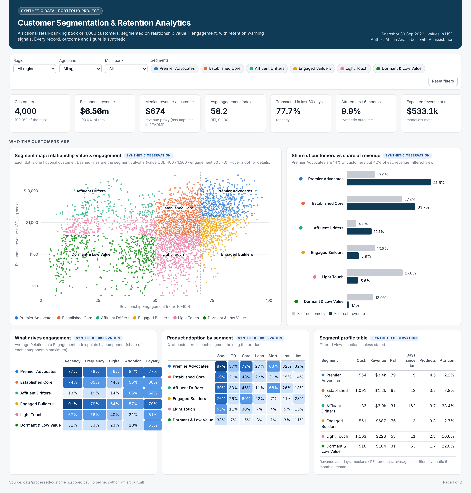

# Customer Segmentation & Retention Analytics | Financial Services

> **All data in this repository is synthetic.** The 4,000 customers are fictional, generated by a seeded simulation (`src/generate_data.py`). No real customer, company or bank data is used. Findings describe the simulated portfolio only.

An end-to-end analytics case study. It segments a fictional retail-banking customer book by **relationship value** and **engagement**, identifies **early warning signals of attrition**, and sizes **hypothetical** retention and growth interventions, with a holdout pilot design to test them.

**Author:** Ahsan Anas · **Built with AI assistance:** see [How this project was built](#how-this-project-was-built).



## Contents
| Deliverable | Where |
|---|---|
| Interactive dashboard (filters, tooltips; opens offline in any browser) | `dashboard/index.html` · PDF: `dashboard/dashboard.pdf` |
| 8-slide case study | `presentation/case_study.pptx` · `presentation/case_study.pdf` |
| Excel workings with live formulas (scorecard, segment rules, summaries, scenarios) | `workbook/segmentation_workings.xlsx` |
| Synthetic dataset: raw (with injected errors) and cleaned / scored | `data/raw/customers_raw.csv` · `data/processed/` |
| Reproducible Python pipeline + tests | `src/` · `tests/` |
| Methodology, cleaning log, data dictionary, validation report | `docs/` |

## Key results (synthetic observations)
| Segment | Customers | % of customers | % of est. revenue | Avg engagement (REI) | 6-month attrition* | Expected revenue at risk** |
|---|---|---|---|---|---|---|
| Premier Advocates | 554 | 13.9% | 41.5% | 78.6 | 2.2% | $90k |
| Established Core | 1,091 | 27.3% | 33.7% | 62.0 | 7.8% | $175k |
| Affluent Drifters | 183 | 4.6% | 12.1% | 30.7 | 28.4% | $181k |
| Engaged Builders | 551 | 13.8% | 6.0% | 75.9 | 2.7% | $13k |
| Light Touch | 1,103 | 27.6% | 5.6% | 52.6 | 10.6% | $58k |
| Dormant & Low Value | 518 | 13.0% | 1.1% | 31.0 | 22.0% | $15k |

\* synthetic outcome label · \*\* model estimate = est. revenue × predicted attrition probability

- **Value is concentrated:** Premier Advocates are 14% of customers but 42% of estimated revenue.
- **The costliest risk is quiet wealth:** Affluent Drifters are 4.6% of customers and 12% of revenue. Their median time since the last transaction is 162 days, their attrition is 28.4%, and they carry 34% of the expected revenue at risk.
- **Engaged but under-served:** Engaged Builders are the most active (REI 76; 84% main bank), but their median revenue is only $687. They are the natural cross-sell test pool.
- **Long tail:** Light Touch and Dormant customers are 41% of customers but 7% of revenue.
- **Warning signals:** the strongest signals are an unused app (registered but no login for 30+ days, 3.0× the book attrition rate), no transaction for 45+ days, 2+ complaints, and deposits down 15%+.
- **Attrition model:** a logistic regression scores AUC 0.81 on a 30% held-out test set, and its top risk decile shows 3.8× the average attrition rate. *The outcome was simulated from the same hidden traits as the features, so this demonstrates the method, not real-world accuracy.*

## Method in brief
1. **Generate:** 4,000 fictional customers built from hidden traits (affluence, engagement, digital propensity, satisfaction), so variables relate realistically. 681 realistic data problems are then injected, and every one is recorded in a ground-truth manifest.
2. **Clean:** 14 logged checks take 4,085 raw rows to 4,000 unique customers. **Nothing is imputed**: blank values stay blank and scores use only the fields available. See `docs/DATA_CLEANING.md`.
3. **Value axis (model assumption):** estimated annual revenue = balances × illustrative margins + card interchange. Bands: High ≥ $1,500 · Mid ≥ $400.
4. **Engagement axis (model assumption):** the Relationship Engagement Index (0–100), weighted recency 30 · frequency 20 · digital 15 · product adoption 20 · loyalty 15. Bands: High ≥ 70 · Mid ≥ 50.
5. **Segments:** the value band × engagement band grid maps to six segments, each with a clear business action.
6. **Robustness:** five alternative weightings keep 84.4–89.7% of customers in the same segment. The engagement cut-off is the most sensitive choice (±5 points → ~80% unchanged). k-means finds little natural cluster structure (silhouette ≈ 0.20–0.22), so transparent rules were preferred.
7. **Retention:** we tested 7 rule-based warning signals against the synthetic outcome and fitted a transparent logistic-regression model. Records with a missing model input are not scored rather than imputed.
8. **Hypothetical interventions and pilot:** three scenarios are sized on explicit assumptions, with a 50/50 holdout pilot and minimum-detectable-effect sizing.

Full details: `docs/METHODOLOGY.md`.

## Validation
`python -m src.validate` runs **39 automated checks; 39 pass.** They cover:
- **Reproducibility:** the same seed gives a byte-identical raw file.
- **Row accounting** from raw rows to clean customers.
- **Cleaning vs ground truth:** every injected issue type is detected.
- **No imputation:** no blank source value was filled in.
- **Re-derived calculations:** the revenue proxy, REI bounds and segment rules are rebuilt independently.
- **Model hygiene:** the outcome is not used as a feature, and results come from a held-out test set.
- **Sensitivity bounds.**
- **Excel = Python:** every customer's revenue, REI and segment match.

`python -m pytest` runs the unit tests. Report: `docs/VALIDATION.md`.

## Quick start
```bash
pip install -r requirements.txt
python -m src.run_all          # generate → clean → score → segment → retention → reports/summary.json
python -m src.build_workbook   # Excel workings with live formulas (recalculate in Excel/LibreOffice on open)
python -m src.validate         # validation report → docs/VALIDATION.md
python -m src.build_dashboard  # dashboard/index.html (+ PDF if Playwright/Chromium is installed)
python -m src.build_docs       # regenerate this README and docs from the outputs
python -m pytest -q            # unit tests
# optional: npm install pptxgenjs && node presentation/build_deck.js
```

## Repository structure
```
├── data/
│   ├── raw/customers_raw.csv              # synthetic, with injected data-quality issues
│   ├── raw/injected_issues_manifest.csv   # ground truth for testing the cleaning
│   └── processed/                         # customers_clean.csv, customers_scored.csv
├── src/                                   # config, generate_data, clean, features, segment, retention, validate, build_*
├── reports/                               # summary.json + CSV outputs (segment summary, signals, sensitivity, model, DQ log)
├── dashboard/                             # index.html (interactive), dashboard.pdf
├── workbook/                              # segmentation_workings.xlsx
├── presentation/                          # case_study.pptx / .pdf, build_deck.js
├── docs/                                  # METHODOLOGY, DATA_CLEANING, DATA_DICTIONARY, VALIDATION
├── linkedin/                              # post copy and cover-image concept
├── assets/                                # dashboard screenshots, cover images
└── tests/
```

## Limitations
- The data is synthetic: relationships exist because the generator created them, so results illustrate method rather than real customer behaviour.
- The revenue proxy uses illustrative margins, not real pricing.
- Segment cut-offs are judgement calls. They have been tested, but they remain choices.
- The attrition model is associative, not causal, and has not been tested on real data.
- Scenario values follow directly from their stated assumptions and are not forecasts.

## How this project was built
Ahsan Anas defined the project, its requirements and confidentiality constraints, and reviewed the outputs. The code, synthetic data generator, dashboard, workbook, slides and documentation were **generated with the help of an AI assistant (Anthropic's Claude)** under his direction. They are presented as a directed, reviewed portfolio piece, not as independently hand-written code.

## License
Code: MIT (see `LICENSE`). Synthetic data and documents: CC BY 4.0.
